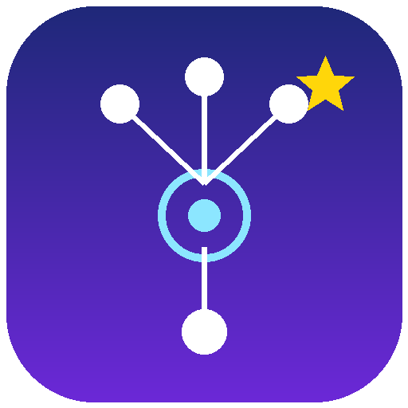

<div align="center">



# ZeroCode Vision Studio

***

**智能型工业机器视觉自动化检测平台**&#x20;

**说句话，让 AI 助手帮你搭视觉检测流程**

## 项目概述

ZeroCode Vision Studio 是一个面向工业制造领域的机器视觉自动化检测平台，采用 WPF + .NET 10 + Prism 插件化架构。它把视觉方案开发中最耗时的三件事——**流程搭建、参数调优、设备对接**——分别交给可视化编辑器、闭环调参工具和统一通讯驱动中心解决；同时内置可与整个软件协同工作的**视觉工程师AI助手**，一句话即可自动搭建流程、诊断故障、扫描调参。

## 核心能力

### 1. 可视化流程编辑（Halcon + OpenCV 双引擎算子）

- **拖拽式编排**：从工具箱拖拽 110+ 视觉算子（Halcon 原生 + OpenCV 实现共存），连线即成流程
- **现代化画布**：点阵背景、贝塞尔流线（带流动动画）、节点状态角标、框选/缩放/平移
- **图像缩略图面板**：画布下方自动显示"读取图像"节点的图像列表，缩略图点击切换画布，支持上一张/下一张循环
- **自动布局**：一键按拓扑整理——主链自上而下、多分支横向并排、前驱重心排序减少交叉
- **单步/全流程/连续运行**：节点级超时看门狗、执行历史记录、耗时分析
- **执行到选定节点为止**：选中流程中任意节点，运行整条流程到该节点即停止，后续节点不执行（调试定位利器）
- **单次循环 / 连续运行缩略图**：底部工具条一键让缩略图从第一张跑到最后一张，单次跑完自动停，连续模式无限循环；运行中再点即停
- **首张 / 末张 / 上一张 / 下一张**：翻图按钮切图后自动执行流程，画布立刻看到该图的算法结果
- **撤销/重做**：全编辑操作可回退，位于流程编辑页面标题栏
- **交互式参数对话框**：画 ROI、实时预览执行结果、参数越界校验

### 2. AI 智能助手（内置 Copilot + MCP Server）

不是套壳聊天窗，而是能让大模型**直接操作软件**的智能体：

- **44 个自动化工具**：查流程状态、批量建链（`build_pipeline` 一次调用搭整条流水线）、增删节点、精确连线、读写参数、执行流程、参数扫描寻优（`sweep_node_parameter`）、节点图像导出、流程体检（`validate_workflow`）等
- **多服务商**：智谱 GLM / DeepSeek / OpenAI 兼容端点 / Google Gemini / Ollama 本地模型，预设一键切换，**每个服务商独立保存 API Key**（DPAPI 加密），模型列表自动拉取
- **多模态输入**：聊天框直接 **Ctrl+V 粘贴 / 拖入 / 📎 附加图片**，配合视口截图与节点输出导出，AI 真的能"看图调参"；纯文本模型自动降级不报错
- **推理模型支持**：GLM 等模型的思考过程（reasoning\_content）实时显示在 💭 折叠块，不再"假死"
- **闭环诊断**：一键故障诊断读统一执行日志（含完整异常堆栈）、错误快照、通讯驱动状态；AI 请求被服务端拒绝时完整报文落盘可查
- **一键方案模板**：缺陷检测 / 尺寸测量 / 模板匹配标准方案秒搭
- **内嵌 MCP Server**：任何支持 MCP 的客户端（Cursor / Claude / ZCode 等）可挂载本软件，共享同一套自动化工具，带 Token 鉴权与限流
- **代码导出**：AI 搭好的流程可导出 HDevelop 脚本 / C# (HalconDotNet) 源码

### 3. 统一通讯驱动中心（12 类协议）

设备对接不再需要在算子里填 IP/端口——所有连接在「工具 → 通讯驱动管理」集中配置、长连接复用，算子只选择驱动名称：

| 类别           | 支持协议                                                                                                                        |
| ------------ | --------------------------------------------------------------------------------------------------------------------------- |
| 网络           | TCP 客户端 / TCP 服务端（多客户端广播）/ UDP / WebSocket                                                                                  |
| 串口           | RS232/485（校验/停止位/波特率全可配）                                                                                                    |
| 工业总线         | **Modbus TCP / Modbus RTU（CRC16）**                                                                                          |
| 消息           | **MQTT**（发布/订阅，主题通配）                                                                                                        |
| **PLC 品牌协议** | **西门子 S7**（S7netplus，S7-200 Smart\~S7-1500）· **三菱 MELSEC MC**（4E 二进制帧，D/W/R/M/X/Y/B）· **欧姆龙 FINS/TCP**（节点自动分配，CIO/W/H/DM 区） |
| 调试           | 虚拟回环驱动（无硬件联调流程）                                                                                                             |

- **驱动管理页**：连接状态/收发统计实时监视、HEX/文本报文监视器、配置导入导出（工位迁移）
- **事件驱动节拍**：驱动收到数据自动触发指定流程（PLC 给信号 → 拍照检测 → 回写结果）
- **智能帧提取**：定长 / 结束符 / 帧头帧尾 / 长度字段四种组帧模式，残帧自动留存
- **通讯算子**：发送/接收（`$Key$` 上游插值）、HTTP 请求、Modbus 读写、**PLC 读取/写入**（位/16 位/32 位/浮点，地址格式 `DB10.DBW0` / `D100` / `CIO100.05`，字节序由驱动内部处理）

### 4. 执行日志与诊断

- **统一执行日志**：流程运行 / 算子执行（含耗时与输出摘要）/ AI 工具调用 / 大模型请求四类事件全记录，**失败带完整异常堆栈**
- **日志查看器**：类别/级别/关键字实时筛选、错误高亮、详情面板、导出、一键打开日志目录
- **落盘策略**：日志在**应用程序根目录** **`logs\`**（现场运维直接可取），按天分文件、10MB 轮转、保留 14 天；AI 失败请求完整报文单独落盘
- **全局异常兜底**：UI 未处理异常先写日志再提示

### 5. 工业相机支持

- 统一 `ICamera` 抽象：海康威视（HIK）SDK、Halcon 通用采集
- 软触发 / 硬触发，曝光、增益、触发延迟等参数可配可存

### 6. 方案与界面

- 方案持久化（多流程、参数、连线完整序列化）、方案库浏览加载
- 亮/暗主题 + 9 色强调色，**切换实时生效**（含已打开窗口）、随配置持久化
- 工作区设置持久化（`%APPDATA%/ZeroCodeVisionStudio/workspace.json`）：启动时工具箱展开/收起状态可在「系统设置 → 界面」页面配置
- 现代化 AI 助手面板：流式打字、工具调用卡片、思考过程、图片气泡

## 项目优势

### 对比传统视觉开发（写 C#/HDevelop 脚本）

| 维度      | 传统开发           | ZeroCode Vision Studio |
| ------- | -------------- | ---------------------- |
| 方案搭建    | 数百行代码/脚本       | 拖拽连线 + AI 一句话生成        |
| 参数调优    | 改代码重跑反复试       | 参数扫描自动寻优 + AI 看图调参闭环   |
| 换设备/换协议 | 改代码重新联调        | 驱动中心换配置，流程零改动          |
| 故障排查    | 靠猜加日志          | 统一执行日志 + AI 诊断 + 报文级记录 |
| 交付迁移    | 整环境拷贝          | 方案文件 + 驱动配置导出          |
| 上手门槛    | 需会 Halcon + C# | 会用鼠标就能搭，会说话就能让 AI 搭    |

### 架构优势

- **插件化算子体系**：新增算子只需实现 `IHandle` + 参数类 + `[Handle]` 特性标注，零侵入注册，热插拔分类展示
- **双引擎算子共存**：Halcon 原生算子和 OpenCV 实现算子并行可用，运行时自动降级（Halcon 不可用时 OpenCV 算子全功能正常）
- **零拷贝执行引擎**：节点间共享参数引用 + 写时复制语义，长流程无重复图像拷贝；算子后台线程执行不冻结 UI
- **AI 与软件同源**：内置 Copilot 与 MCP Server 共用同一工具目录与执行入口，一条埋点全覆盖审计
- **全链路可观测**：从流程执行到 AI 每一次工具调用都有日志、有耗时、有堆栈

## 适用人群

| 人群               | 价值                                                                                   |
| ---------------- | ------------------------------------------------------------------------------------ |
| **视觉工程师**        | 告别重复搭积木：常用检测流程 AI 一句话生成，参数扫描自动寻优，故障看日志+AI 诊断而非逐节点排查；导出 HDevelop/C# 代码无缝衔接既有工具链       |
| **自动化 / 设备工程师**  | 不写代码即可打通"PLC 给信号 → 视觉检测 → 结果回写"完整节拍；西门子/三菱/欧姆龙直接配置连接，Modbus/TCP/串口全在驱动中心             |
| **中小设备商与集成商**    | 商业视觉平台按席位+加密狗授权动辄数万，本项目零授权成本、方案文件+驱动配置即迁移；插件体系支撑差异化定制                                |
| **高校 / 科研 / 学生** | 免费的工业级视觉实验平台：110+ 算子覆盖教科书全流程（Halcon + OpenCV 双引擎），AI 助手边做边解释（"为什么这里用形态学闭运算"），比啃手册快十倍 |
| **个人开发者 / 创业者**  | 快速原型验证检测想法；Ollama 本地模型零 API 成本、数据不出机器；MCP 接口让外部 AI 工具链直接驱动它                          |
| **工厂产线维护人员**     | 执行日志 + 报文监视 + AI 一键诊断，现场问题不再依赖原厂支持                                                   |

## 竞品对比

| 维度     | Halcon HDevelop | 海康 VisionMaster | Cognex VisionPro/Designer | 云端 AI 视觉平台 | **本项目**                       |
| ------ | --------------- | --------------- | ------------------------- | ---------- | ----------------------------- |
| 形态     | 脚本 IDE          | 低代码 + 加密狗       | 低代码 + 授权                  | SaaS/私有云   | **低代码 + AI 智能体（开源）**          |
| 授权成本   | 数万\~数十万/年       | 数万/席位           | 数十万级                      | 按量/按年订阅    | **免费（Halcon 运行时需自备授权）**       |
| 使用方式   | 写 HDevelop 脚本   | 拖拽模块            | 拖拽/电子表格                   | 上传标注训练     | **拖拽 + 自然语言，两者可混用**           |
| AI 能力  | 无               | 无大模型集成          | 无大模型集成                    | 仅图像分类/缺陷检测 | **LLM 智能体直接操作软件：搭建/调参/诊断全代管** |
| 设备通讯   | 需自写 socket      | 常规协议            | 常规协议                      | 依赖网关       | **12 类协议 + 三大 PLC 品牌协议内置**    |
| 视觉算法底座 | Halcon 全量       | 自研              | 自研                        | 深度学习为主     | **Halcon + OpenCV 双引擎经典算法**   |
| 二次开发   | C#/.NET         | 受限 SDK          | 受限 SDK                    | 无          | **C# 插件零侵入注册 + 完整源码**         |
| 数据隐私   | 本地              | 本地              | 本地                        | 上云         | **本地 + 可选本地大模型（数据不出厂）**       |
| 交付物    | 脚本/EXE          | 专有运行时           | 专有运行时                     | 云端服务       | **方案文件 + 可导出 HDevelop/C# 源码** |

> 说明：商业产品在长期产线打磨、官方认证支持、特定行业算法包上有深厚积累；本项目强在**成本、开放性、AI 原生体验**，适合预算敏感、需要深度定制、或想用 AI 提效的场景。

## 独有功能（目前同类产品中未见的组合）

1. **能动手的 AI 助手**——不是聊天侧栏，是 44 个工具武装的智能体：`build_pipeline` 一次调用搭完整条流水线、`sweep_node_parameter` 逐档执行流程并回传物理量做参数寻优、`get_execution_logs` 读带堆栈的执行日志做根因诊断、`validate_workflow` 上线前体检——形成"搭建 → 执行 → 看图 → 调参 → 诊断"完整代理闭环
2. **AI 直接看图调参**：视口截图/节点中间结果导出后自动进入多模态对话，视觉模型（glm-5.3-flash / gpt-4o / gemini）真的在"看着"你的二值化结果告诉你阈值差多少；聊天框还能直接粘贴/拖入现场不良品照片
3. **双引擎算子体系**：Halcon 原生算子 + OpenCV 实现算子并行可用，运行时自动降级；Halcon 不可用时 OpenCV 算子全功能正常，画布图像走 WPF BitmapFrame 兜底显示
4. **MCP 开放协议接入**：软件本身就是一个 MCP Server——Cursor / Claude / ZCode 等任意 AI 客户端可挂载并驱动它，等于把整个视觉平台变成你现有 AI 工具链的一个"外设"
5. **三大 PLC 品牌协议与视觉低代码同框**：S7/MC/FINS + 驱动中心 + 接收触发流程，一台软件完成"眼 + 手"协同，无需中间网关程序
6. **推理模型思考过程可视化**：GLM 等推理模型的 reasoning\_content 实时显示，AI"执行到一半"不再像假死
7. **本地大模型零成本运行**：Ollama 预设开箱即用，无 Key、无外发，满足保密产线
8. **从低代码到源码的单向门**：可视化流程随时导出 HDevelop 脚本 / C# 源码——用低代码起步，不留锁定后患

## 为什么选择本项目

- **成本**：平台本身零授权，只需 Halcon 运行时；AI 可用本地模型零 API 费用
- **效率**：AI 搭建 + 参数扫描 + 日志诊断，把视觉工程师从重复劳动里解放出来（实测：一句话生成 9 节点缺陷检测流程并跑通，全程约 1 分钟）
- **开放**：全源码 + 插件体系 + MCP 协议，任何一层都能改——商业平台改不了的这里都能改
- **可信**：所有 AI 行为有日志、有耗时、有堆栈；失败请求完整报文落盘；导出源码随时可脱离平台
- **低门槛高上限**：新手靠 AI 边做边学，工程师靠插件和源码深挖——同一套工具覆盖从教学到产线的跨度

## 项目结构

```
VisionFlow-AI-Studio/
├── ZeroCode.Vision.SDK/           # 相机 SDK 抽象（ICamera 统一接口）
├── ZeroCode.Vision.SDK.HK/        # 海康相机实现
├── ZeroCode.Vision.SDK.Halcon/    # Halcon 通用采集实现
│
├── ZeroCodeVisionStudio.Core/     # 算子注册中心 / 运行时模型
├── ZeroCodeVisionStudio.Shared/   # 共享库
│   ├── Communication/             #   通讯驱动中心（12 类协议 + PLC）
│   ├── Diagnostics/               #   统一执行日志服务
│   ├── Halcon/                    #   Halcon 辅助（元组转换/资源管理）
│   ├── Handles/                   #   算子基类体系
│   ├── Parameters/                #   参数系统（驱动下拉等编辑器）
│   └── Themes/                    #   主题管理 + 插件对话框样式
├── ZeroCodeVisionStudio.AI/       # AI 子系统
│   ├── Copilot/                   #   内置智能体引擎（上下文/多模态/节流）
│   ├── Mcp/                       #   内嵌 MCP Server（Token 鉴权）
│   ├── Tools/                     #   44 个自动化工具目录
│   └── Config/                    #   服务商预设/密钥加密/视觉模型识别
├── ZeroCodeVisionStudio.UI/       # 工作流编辑器、对话框、主题令牌
├── ZeroCodeVisionStudio/          # 主程序（主界面/通讯管理页/日志查看器/AI 面板）
│
├── Plugins/                        # 算子插件（按功能分类）
│   ├── ImageInput/                #   读图 / 海康相机
│   ├── Preprocessing/             #   滤波/边缘/增强等 12+（含 OpenCV 实现）
│   ├── Segmentation/              #   阈值/边缘/线条等 10+（含 OpenCV 实现）
│   ├── RegionProcessing/          #   连通/形态学/筛选等（含 OpenCV 实现）
│   ├── ShapeMatching/             #   形状模板创建/查找/缩放匹配
│   ├── Measurement/               #   缺陷/距离/角度/几何测量
│   ├── GrayFeature/ ShapeFeature/ #   灰度与形状特征
│   ├── ContourProcessing/         #   轮廓处理
│   ├── ResultOutput/              #   结果输出
│   └── DeviceCommunication/       #   通讯算子（发送/接收/HTTP/Modbus/PLC）
│
├── halcon-mcp-bridge.py            # MCP stdio 桥接（CLI 客户端挂载用）
└── HalconVS.slnx                   # 解决方案
```

## 技术栈

- **.NET 10** / **WPF** / **C# 13**
- **Prism 9**（MVVM + 模块化 + Unity DI）
- **Halcon**（halcondotnet，全部视觉算法）+ **OpenCvSharp4**（OpenCV 算子实现）
- **MahApps.Metro**（UI 基础）+ 自建设计令牌主题系统
- **MQTTnet**（MQTT 驱动）、**S7netplus**（西门子 S7）、**System.IO.Ports**（串口）
- MC（三菱）/ FINS（欧姆龙）协议为自实现（帧结构经多源核对，首用建议现场联机验证）
- **DPAPI**（密钥本地加密存储）

## 快速开始

### 环境要求

- Windows 10/11
- .NET 10 SDK
- Halcon 运行时（许可，可选——无 Halcon 时自动降级为 OpenCV + WPF BitmapFrame）
- 海康 MVS（可选，用海康相机时）

### 编译运行

```bash
git clone https://gitee.com/ZeroCode/VisionFlow-AI-Studio.git
cd VisionFlow-AI-Studio
dotnet build HalconVS.slnx
```

或用 Visual Studio 2022+ 打开 `HalconVS.slnx`，还原 NuGet 后 F5。或直接在根目录下运行exe执行程序。

### 使用流程

1. **建方案、搭流程**：工具箱拖算子 → 连线 → 双击节点配参数；或点 AI 面板「📐 缺陷检测模板」/ 直接说需求
2. **配设备**：「工具 → 通讯驱动管理」新建驱动（TCP/串口/Modbus/PLC…）→ 通讯算子下拉选择该驱动
3. **加载图像**：拖入"读取图像"节点 → 选文件列表 → 画布下方缩略图栏自动显示 → 点缩略图/首张/上一张/下一张/末张切换，切图后自动执行流程
4. **调参数**：选中节点 → 点底部 ▶▶ "执行到选定节点"（只跑到该节点停止）→ 闭环验证；或让 AI 参数扫描
5. **跑产线**：连续运行 / 驱动接收触发；「工具 → 执行日志」看全程记录
6. **要交付**：保存方案文件，驱动配置导出 JSON，`export_hdevelop_script` / `export_csharp_code` 导出代码

### 让外部 AI 客户端接入（MCP）

软件内置 MCP Server（默认端口 8765，Token 鉴权），AI 设置页可一键复制 Cursor / Claude Code / ZCode 的挂载配置；`halcon-mcp-bridge.py` 提供 stdio 桥接。

## 扩展开发：编写自定义算子

```csharp
public class MyParameter : IHandleParameter
{
    [DisplayName("半径")]
    public double Radius { get; set; } = 10;
    public IHandleParameter Clone() => (MyParameter)MemberwiseClone();
    public void Reset() => Radius = 10;
}

[Handle("我的算子", "MyOperator", "说明：做什么用", "自定义分类")]
public class MyHandle : ParameterHandleBase<MyParameter>, IHandleDataSlots
{
    public MyHandle(IDialogService dialogService) : base(dialogService) { }

    public override void Handle()
    {
        // RunParameter 里取上游图像/区域，SetOutput 输出结果
    }
}
```

参数属性还支持 `[Range]`（滑条+越界校验）、`[FileDialog]`（文件选择）、`[DriverOptions(...)]`（通讯驱动下拉，自动过滤驱动类型）等编辑器特性——**算子 DLL 丢进插件目录即完成注册**。

## 许可证

本项目基于 [MIT License](LICENSE) 开源。Halcon 运行时授权需自行向 MVTec 获取；第三方依赖遵循各自协议。

## 贡献与联系

仍在完善中，欢迎共建。
